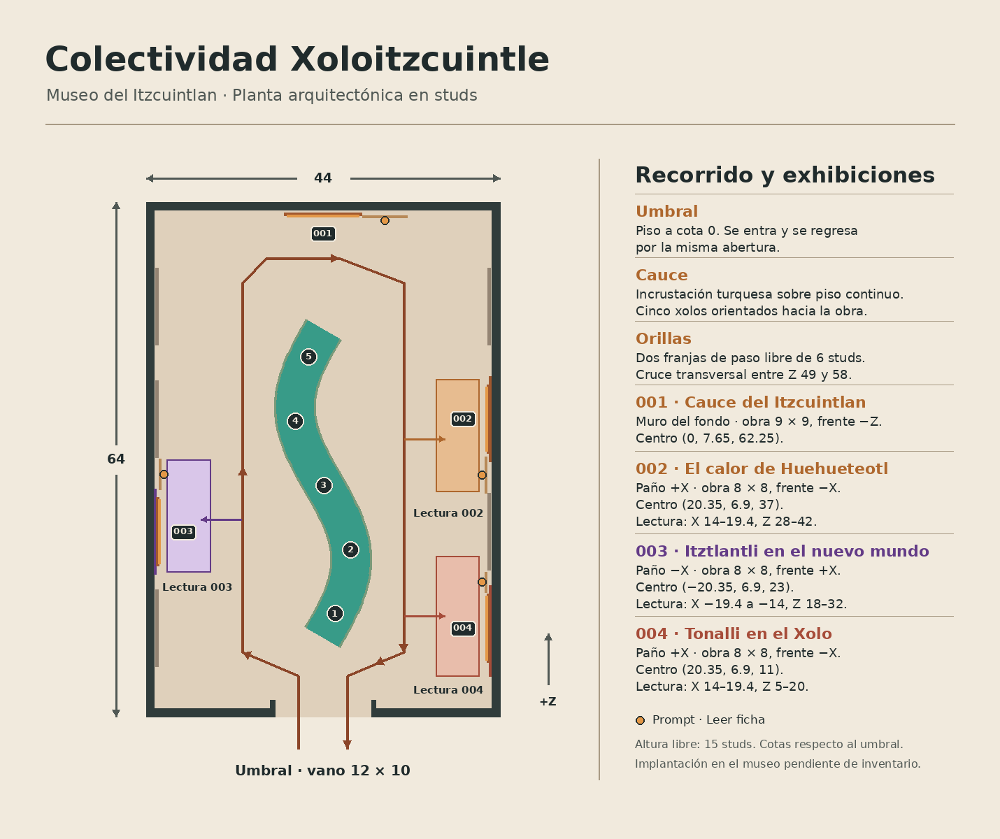

# Arquitectura de Colectividad Xoloitzcuintle

Desde el umbral, el cauce turquesa y las cinco figuras de basalto mantienen el eje hacia «Cauce del Itzcuintlan». En +X, «Tonalli en el Xolo» abre el recorrido con terracota, luz solar y tres cactus floridos. Más adelante se alternan el eclipse violeta de «Itztlantli en el nuevo mundo» en −X y el brasero ámbar de «El calor de Huehueteotl» en +X. Cada obra lateral tiene su propia franja de lectura a la cota del piso.



| Elemento | Medidas y cotas locales en studs |
| --- | --- |
| Envolvente | X −22…22, Z 0…64. Altura libre 15. Piso de 1 de espesor y cubierta entre Y 15 y 16. |
| Umbral | Centro (0, 0, 0). Vano de 12 × 10. +Y arriba y +Z hacia la obra inaugural. El rótulo de regreso mira al interior. |
| Piso y recorridos | Piso continuo a Y=0. Franjas de 6 studs centradas en X ±10. Cruce transversal entre Z 49 y 58. |
| Cauce | Z 10…48. Centro `x = 3.5 sin((z−10)π/19)`. Orilla de 5.1 de ancho y agua de 4.55. Incrustación sobre piso continuo. |
| Procesión | Cinco figuras en Z 13, 21, 29, 37 y 45. Cada una tiene giro y zancada propios. |
| 001 · Cauce del Itzcuintlan | Obra 9 × 9 en (0, 7.65, 62.25), frente −Z. Placa en (7.7, 4.6, 62.18) y prompt en (7.7, 3.85, 61.68), con alcance de 9 studs. |
| 002 · El calor de Huehueteotl | Obra 8 × 8 en (20.35, 6.9, 37), frente −X. Placa en (20.28, 4.6, 30.05) y prompt en (19.78, 3.85, 30.05), con alcance de 7 studs. |
| Lectura 002 | X 14…19.4, Z 28…42. El corredor +X ocupa X 7…13. La franja de lectura es espacio libre sobre el piso. La luminaria y el brasero están fijados al paño. |
| 003 · Itztlantli en el nuevo mundo | Obra 8 × 8 en (−20.35, 6.9, 23), frente +X. Placa en (−20.28, 4.6, 30.15) y prompt en (−19.78, 3.85, 30.15), con alcance de 7 studs. |
| Lectura 003 | X −19.4…−14, Z 18…32. El corredor −X ocupa X −13…−7. El eclipse y el marco están montados en pared. |
| 004 · Tonalli en el Xolo | Obra 8 × 8 en (20.35, 6.9, 11), frente −X. Placa en (20.28, 4.6, 16.70) y prompt en (19.78, 3.85, 16.70), con alcance de 6 studs. |
| Lectura 004 | X 14…19.4, Z 5…20. La placa termina en Z 18.0 y el paño siguiente empieza en Z 18.2. El prompt de 004 queda a 13.35 studs del de 002, con radios de 6 y 7. |
| Directorio | Centro (0, 12.32, 15), frente al acceso (−Z) y borde inferior Y 10.76. Las flechas indican 004 y 002 a la izquierda del visitante, 003 a la derecha y 001 al fondo. |
| Expansión | Los otros paños de pizarra siguen disponibles. `Catalogo.json` aporta los metadatos de la serie, `Artworks.luau` los textos interpretativos y `Displays.luau` las posiciones, giros y dimensiones del montaje. |

La ficha amplía la placa con texto de alto contraste y desplazamiento vertical. La validación de cámara, navegación y legibilidad en dispositivo está en la [lista de aceptación](validacion.md).

## Comparación para revisión con Astra

El paño +X a Z 11 ofrece un primer punto de lectura lateral entre el acceso y Huehueteotl. La alternativa −X a Z 51 situaría la lectura junto al cruce transversal Z 49…58 y competiría con la aproximación a 001. La planta conserva los corredores de 6 studs y la envolvente de 44 × 64. [Comparativa de tres y cuatro estaciones a la misma escala](evidencia/comparativa-etapa4.png).

## Previsualización

Blender usa las posiciones, medidas, colores y rótulos exportados desde Luau. Sus luces y cámaras son de previsualización. Las cuatro obras se muestran con sus PNG canónicos verificados. Los marcos de la maqueta Roblox muestran el aviso de asset pendiente.

| Vista | Imagen |
| --- | --- |
| Cuatro exhibiciones | [Perspectiva de conjunto](evidencia/cuatro-estaciones.jpg) |
| Cauce del Itzcuintlan | [Marco y placa](evidencia/obra.jpg) |
| El calor de Huehueteotl | [Marco, placa, petate y brasero](evidencia/huehueteotl.jpg) |
| Itztlantli en el nuevo mundo | [Marco, placa y eclipse](evidencia/itztlantli.jpg) |
| Tonalli en el Xolo | [Terracota, sol y tres cactus](evidencia/tonalli.jpg) |
| Volumen y recorridos | [Axonometría sin cubierta](evidencia/axonometria.jpg) |
| Acceso y circulación | [Entrada](evidencia/entrada.jpg) · [Procesión](evidencia/procesion.jpg) · [Regreso](evidencia/retorno.jpg) |

Las capturas y el video de Studio quedan pendientes de una prueba ejecutada en la copia del museo.

### Regenerar la previsualización

Desde la raíz del repositorio, con Lune 0.11.1, Blender 4.3 y Python con Pillow. Obtén los PNG en `originales` mediante [el procedimiento de verificación](obra.md).

```sh
lune run colectividad/tools/export_preview.luau sala.json
git show 7e3cd1c:colectividad/docs/evidencia/planta.png > planta-etapa3.png
python3 colectividad/tools/draw_plan.py sala.json planta.png --compare planta-etapa3.png
blender -b --factory-startup --python-exit-code 1 \
  --python colectividad/tools/render_preview.py -- sala.json originales renders
```
