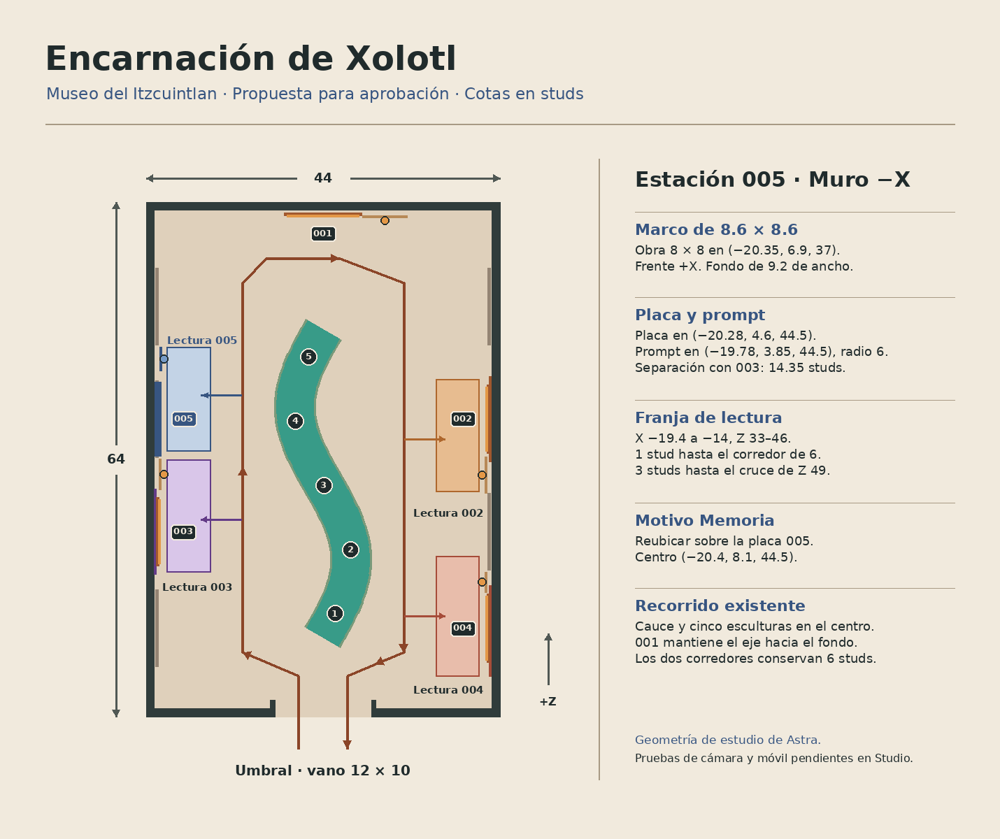

# Evaluación de Astra · Encarnación de Xolotl

Astra evaluó la sala de cuatro estaciones en el commit [63de9d5188d10ffd7862227a0ca5fbded6efb7eb](https://github.com/xolosArmy/xolosarmy_roblox_nft_gallery/commit/63de9d5188d10ffd7862227a0ca5fbded6efb7eb). Su recomendación es probar un montaje mural en **−X, Z 37**, frente a Huehueteotl. La quinta obra cabe en la envolvente de 44 × 64 studs según las cotas del modelo. El montaje requiere aprobar la reubicación del motivo «Memoria» y comprobar en Studio el equilibrio visual, la cámara, la lectura y el rendimiento.

| Elemento | Propuesta en coordenadas locales |
| --- | --- |
| Obra y marco | Obra de 8 × 8 en (−20.35, 6.9, 37), frente +X. Marco de 8.6 × 8.6 en (−20.60, 6.9, 37). |
| Paño | Fondo de piedra azul grisácea de 9.2 studs de ancho, Z 32.4–41.6. Quedan 0.35 studs respecto al extremo de la placa de 003. |
| Placa | 3 × 3.15 en (−20.28, 4.6, 44.5), frente +X. Ocupa Z 43–46 y deja 0.20 studs hasta el paño siguiente. |
| Prompt | (−19.78, 3.85, 44.5), radio de 6. Está a 14.35 studs del prompt de 003, cuyos 7 studs de radio dejan un margen de 1.35 studs entre alcances. |
| Lectura | X −19.4…−14, Z 33…46. La franja deja 1 stud hasta el corredor de 6 studs y 3 studs hasta el inicio del cruce Z 49–58. |
| Motivo «Memoria» | Trasladar sus 12 piezas juntas de (−20.4, 6.9, 37) a (−20.4, 8.1, 44.5), por encima de la placa. |

Desde el umbral, «Cauce del Itzcuintlan» conserva el eje al fondo. Los montajes laterales se reparten en pares sobre las dos paredes y dejan libre el cruce final. La paleta azul nocturno y gris piedra acompaña el reflejo de Venus en el estanque oscuro. La previsualización muestra tres filetes murales opcionales debajo de la imagen. La propuesta reserva el piso para la circulación. [Detalle conceptual en Blender](evidencia/propuesta-encarnacion.jpg) · [Vista en relación con Itztlantli y el cauce](evidencia/propuesta-encarnacion-contexto.jpg).

| Alternativa | Evaluación de Astra |
| --- | --- |
| −X, Z 51 | El marco cabe y una placa hacia Z 44.5 separa los prompts. La lectura ocuparía parte de Z 49–58, donde se cruza hacia 001. |
| −X, Z 11 | El marco cabe y los prompts se separan. Enfrenta dos obras de 8 × 8 junto a la llegada y ocupa el paño del motivo «Viento». |
| +X, Z 23 | La estación quedaría entre las placas de 004 y 002, en el paño del cempasúchil. Hay menos margen para darle espacio propio. |

Astra considera innecesario un anexo para la primera prueba de diseño. Si la cámara o el flujo de visitantes invalidan −X a Z 37, se deberá revisar el volumen disponible de la copia del museo antes de proponer una cámara contigua.

La Etapa 4 exporta 415 piezas. Al sustituir el paño, la propuesta estima 414 piezas con el montaje básico y 417 con los tres filetes. Añadiría una imagen, una placa, un prompt y una luz local azul grisácea sin sombras y con alcance máximo propuesto de 9 studs. La comparación de cuatro y cinco estaciones en escritorio y móvil sigue pendiente. En Studio, comprobar la lectura de ambas placas en −X, dos visitantes simultáneos en la franja y el corredor, el giro de cámara, la vista de 001 desde el umbral y el tiempo de fotograma y memoria en el mismo dispositivo.

La obra de 1254 × 1254 px y 3,125,566 bytes coincide con el SHA-256 `7d05313c724e45cbc8e8daf9124dc18b36902de242f13991f313df19e2da6709`. El minteo y el anuncio Tonalli Memo constan en el bloque 975410. El PNG canónico se usó en el estudio de Blender. El montaje de la quinta estación y la importación de su imagen en Roblox quedan pendientes de aprobación. [Ficha curatorial](https://xolosarmy.xyz/blog/colectividad-xoloitzcuintle/encarnacion-de-xolotl/) · [PNG canónico](https://xolosarmy.xyz/assets/colectividad-xoloitzcuintle/encarnacion-de-xolotl.png) · [Token](https://explorer.xolosarmy.xyz/token/717d555b1ecc1f701c8273fe3fb4d80954d1eca26874188584e6facd9f0634ba) · [Anuncio](https://explorer.xolosarmy.xyz/tx/c98bd3482477680413d78f82642204721e94869e4c9c78dba9ec6013ed1ff3eb).
